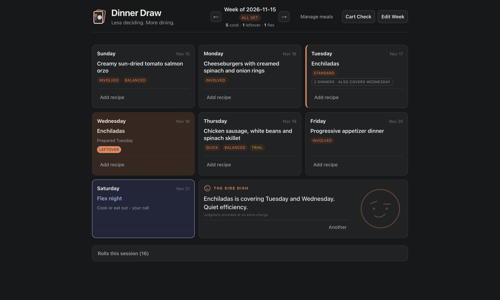

# Dinner Draw

**Less deciding. More dining. Occasional unsolicited commentary.**

Dinner Draw is a weekly dinner planner for a household that already knows what it likes to eat but somehow still ends up negotiating with itself every Sunday. Roll a week of dinners, adjust it, account for leftovers, and lock it in before the grocery order.

*The meals are familiar. The indecision is apparently endless.*

## The problem

Every Sunday, the same question came up: what are we eating this week. Nobody wanted to own the answer. With working parents and kids, choosing meals from scratch every week—even meals we'd happily eat again—took more mental effort than it should have for a decision we'd already effectively made a dozen times before.

The problem was never finding recipes. We have plenty we like. The problem was the blank page: deciding, from memory, under time pressure, on a Sunday, what to assign to seven nights, while also making room for leftovers, a night that doesn't need a plan at all, and the fact that some nights are already spoken for before the rest gets figured out.

## What Foundry produced

A 7-day rotation board generated from a saved meal catalog. **Roll the Week** fills the board from meals already in the catalog. From there:

- **Lock** a night to protect it from a reroll, and **reroll** one night, a selection, or everything still unlocked. Move a dinner, mark a night not needed, exclude a meal for the week, or add a one-week custom meal.
- **Leftovers are paired.** Any meal can be made to cover a second night, and meals flagged as good for two dinners are paired with a later night automatically. The pair stays together through rerolls and moves, and changing the source night undoes it.
- **Effort fits the day.** Meals are tagged survival, quick, standard or involved, and the roll leans lighter midweek and heavier when there's time. It caps experiments at one Trial meal per week, keeps weekend-only meals off weeknights, and softly avoids repeating last week's board.
- Every full reroll is kept in a session history, so this week's board can be compared against the last few rolls before it's set, not just accepted on faith the first time it looks reasonable.
- A flex night sits in the board as its own slot, not a leftover gap.
- **Set Week** makes the board final and read-only; **Edit Week** reopens it.
- **Cart Check** copies a grocery-review prompt with the week's plan, to paste alongside a cart PDF into an assistant.
- **The Side Dish** provides unsolicited commentary on planning decisions. Reroll too many times and it starts questioning your commitment; finally set the week and it offers reluctant congratulations. ("Four rolls in. Either this is thorough or it's becoming a hobby.") The commentary is local and event-driven, and it has no influence over the actual dinner plan.

It runs locally on Python's standard library, with no external dependencies or third-party API calls. It saves to a JSON file and has a unit test suite covering the selection logic, leftovers, and board actions.

## The operators

It's built for our household, and so far it's been run only by me, as resident chef. It's now my default weekly planner, used for real weeks of real meals, not a demo week. Whether it ends up shared is the adoption question that matters most.

## Product decisions worth naming

- **The meal catalog is hand-authored, not imported or AI-generated.** We know what we actually eat. A generated or scraped list would need to be curated down to that same set anyway, so skipping straight to a hand-authored catalog, edited in the app, was the shorter, more honest path. New meals enter as Trial, and the roll limits how many appear in a week.
- **Leftovers are suggested but always visible and reversible.** Meals flagged as good for two dinners are paired automatically, and any meal can be paired by hand. Locked nights and the flex night are never used as leftover targets, and an undo restores the original dinner. A wrong pairing (serving something as fresh that's actually a leftover, or vice versa) is a worse failure than a missed one, so the pairing is always shown on the board.
- **No nutritional tracking, and the grocery step stays human.** The problem being solved was planning friction (the blank-page Sunday moment), not nutrition. Grocery friction turned out to be real once the plan existed, so **Cart Check** now copies a structured review prompt and the weekly schedule, to use with an existing cart PDF. It doesn't generate a complete grocery list, inspect ShopRite carts, manage pantry inventory, or place orders. The boundary is deliberate: support the human decision with useful information without automating the whole shopping workflow.
- **The app can judge your decisions. It cannot make them for you.** The Side Dish reacts to planning behavior, and clicking the logo reveals a completely unnecessary dinner fortune. Neither changes meal selection, modifies the schedule, or calls an external AI service. The humor is intentional; the consequences are nonexistent. The principle underneath is that personality stays separate from consequential actions.
- **Flex night is a first-class concept.** An empty night invites the same "what are we doing" conversation the whole tool exists to avoid. Flex night is planned as a night, it just isn't planned as a meal.

## Current state

This tool went through real iteration before it settled, not just upfront shaping: running an early version against actual Sundays surfaced friction (locking a night I'd already decided on, friction just adding a new meal to the catalog, among other things) that only showed up from using it, even though I was the only user. Leftover pairing, Cart Check and the rest of the current feature set came from the same place: friction observed in actual weeks, not requirements imagined in advance. It replaced the manual notepad that did this job before, and it's what I actually reach for every week now. What it solves is real, even at this scale: it takes the burden of inventing a plan off me on a day when, as an exhausted parent, generating one more decision from scratch is exactly the kind of load I don't have spare capacity for. It's also, genuinely, fun to use, which turns out to matter for something you open every week.

## The next bounded step

Two questions are still open, and both are for continued use to answer rather than reasons to build more:

- **Does it become a shared household tool,** or does it stay something one person maintains for everyone else? The real test is whether my wife reaches for it too.
- **Does the Cart Check handoff consistently reduce grocery-order friction** over several weeks? Anything beyond that handoff, such as deeper shopping assurance, is an unproven hypothesis, not something built or planned.

## What this demonstrates

This wasn't "we need a meal-planning app." It was noticing that the actual bottleneck was a recurring decision, not a lack of options, and scoping a first version to remove exactly that friction, without pulling in nutrition tracking or a grocery system just because they were adjacent. Scope discipline was only half of it. The other half was letting real use decide what earned its way in: leftover pairing and Cart Check arrived because the friction showed up, not because they were on a list.

The last piece is deliberate: a tedious weekly chore is easier to keep doing if it's pleasant, so the app has a personality. It's kept strictly apart from the decisions, so the joking never touches the plan.
